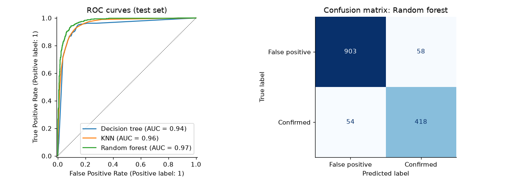

# 🪐 Kepler Exoplanet Classification

Machine Learning pipeline to classify **9,564 Kepler Objects of Interest (KOI)** from the NASA Exoplanet Archive into **confirmed planets vs false positives**, with a strict focus on **preventing data leakage**.

> **Status: main experiments complete.** Next: hyperparameter search and a repeated-split evaluation.



## 🎯 Problem
Kepler detects planets from tiny dips in a star's brightness (transits). Many signals are not planets (eclipsing binaries, instrument artefacts). Goal: predict whether an object is a confirmed planet from physical measurements (orbital period, transit depth and duration, planet radius, stellar temperature, signal-to-noise…) and evaluate models honestly.

## 🔍 Data audit (done): `notebooks/01_data_audit.ipynb`
- 9,564 rows × 49 columns, no exact duplicates.
- Classes: FALSE POSITIVE 50.6%, CANDIDATE 24.7%, CONFIRMED 24.6%, so accuracy alone is not enough (F1 and AUC are used).
- Two columns are 100% empty; `kepler_name` is 75% missing; `koi_score` is 16% missing.
- Data-quality anomaly: one `koi_fpflag_nt` value of 465 in a binary flag.
- **Leakage review**: `koi_pdisposition`, `koi_score` and the `koi_fpflag_*` flags come from the vetting process that produces the label, so they are excluded from the features. 16 physical measurements remain as candidates; notebook 02 keeps 13 of them (epoch and sky position are dropped) and sets the `_err` columns aside.

## 🧩 Pipeline
1. **Binary task**: CONFIRMED (planet) vs FALSE POSITIVE; the 2,367 CANDIDATE objects have no verdict and are excluded → 7,197 objects (32.7% positive).
2. **Cleaning with a log** (`results/cleaning_log.csv`, `results/columns_dropped.csv`): leakage columns removed, 13 physical features kept.
3. **Leakage-safe validation**: split **by star** (`kepid`, 586 stars have several KOIs) and 5-fold `StratifiedGroupKFold`; log transform, scaling, imputation and PCA are fitted **inside each fold**.
4. **Comparison**: 3 imputations (mean, median, KNN) × 3 models (KNN, decision tree, random forest) × with/without PCA, selected on CV F1, then evaluated **once** on a held-out test set.

## 📊 Results (held-out test set, 1,433 objects)
Best configuration of each model, chosen by cross-validated F1 on the train set:

| Model | Imputation | PCA | CV F1 | Test F1 | Test AUC | Precision | Recall |
|---|---|---|---|---|---|---|---|
| Random forest | median | no | 0.885 | 0.882 | 0.973 | 0.878 | 0.886 |
| KNN | mean | no | 0.847 | 0.849 | 0.957 | 0.798 | 0.907 |
| Decision tree | mean | no | 0.851 | 0.846 | 0.940 | 0.811 | 0.883 |

**Findings**
- **Random forest wins** (test F1 0.882, AUC 0.973); KNN and decision tree are ~3 points lower.
- **Imputation barely matters**: mean ≈ median (CV F1 0.884 / 0.885), KNN slightly lower (0.876); differences are within fold-to-fold noise (±0.006).
- **PCA hurts** (random forest 0.885 → 0.837): 8 components hold 95% of the variance but discard what separates the classes.
- **Drivers**: planet radius, transit signal-to-noise, impact parameter, duration (`results/feature_importance.csv`).
- **Errors** concentrate on small, low-SNR objects (median SNR 22 vs 38): 58 false alarms kept, 54 planets missed (`results/test_errors.csv`).

**Honest limits**: single hold-out split, no hyperparameter search. The vetting flags (`koi_fpflag_*`, `koi_score`, `koi_pdisposition`) are excluded on purpose because they come from the labelling process; scores obtained *with* them are higher but not comparable.

## ▶️ Run
```bash
git clone https://github.com/marwen-benhajkacem/kepler-exoplanet-classification.git
cd kepler-exoplanet-classification
pip install -r requirements.txt
jupyter nbconvert --to notebook --execute --inplace notebooks/02_cleaning.ipynb notebooks/03_models.ipynb   # or open them in Jupyter
```
[](https://colab.research.google.com/github/marwen-benhajkacem/kepler-exoplanet-classification/blob/main/notebooks/01_data_audit.ipynb)

## 📁 Structure
```
data/        exoplanets.csv + data notes
notebooks/   01_data_audit, 02_cleaning, 03_models
data/        raw table + processed/koi_binary_clean.csv
results/     CV and test metrics, importance, error log, figures
docs/        report
```

## 👤 Author
Marwen Ben Haj Kacem · Master's in Data Science, ISIMA · Data: NASA Exoplanet Archive.
